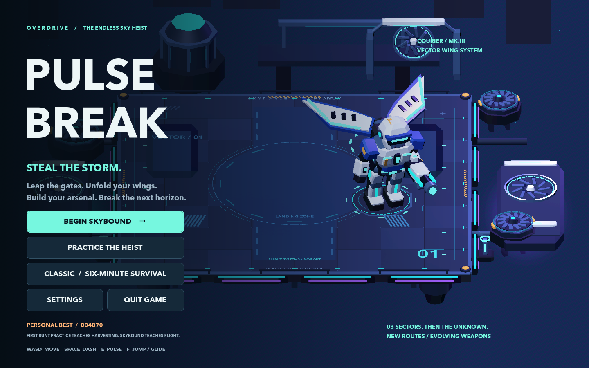
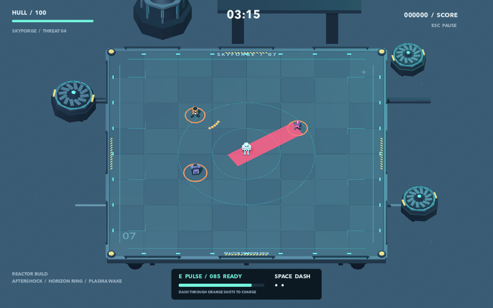

# Pulsebreak

**Steal the storm. Break the machine.** A native Mac arena roguelite with endless generated sectors, evolving weapons, and an original dubstep soundtrack.

**[Download Pulsebreak 1.4.3 for Mac](https://github.com/xindomusic/pulsebreak/releases/download/v1.4.3/Pulsebreak-1.4.3-macOS-universal.zip)** · [All releases](https://github.com/xindomusic/pulsebreak/releases) · [Changelog](CHANGELOG.md)

Unzip **Pulsebreak.app**, move it to Applications, and choose **Begin Skybound**. The universal app runs on Apple Silicon and Intel Macs, fully offline — no account, no API key, no Godot required. It is ad-hoc signed rather than Apple-notarized; see the [first-launch guidance](docs/GETTING_STARTED.md#play-the-download) if macOS asks before opening it.



[Hear Prism Drive](docs/audio/prism/prism_drive.mp3) · [Music and combat preview](docs/audio/prism/battle_preview.mp3)

## The game

Fly a winged courier mech through a sky-foundry heist. Your weapons fire on their own — the game is movement, timing, and one core move:

1. **Dash through orange shots** to absorb them and steal their energy.
2. **Spend stored energy on a pulse.** More charge means a larger, stronger blast.
3. **Jump and glide** over low shots, gates, and ground hazards; read each enemy's warning before it commits.
4. **Install upgrades** at checkpoints, then push into the next sector or bank your score.

Two ways to play:

- **Begin Skybound** — endless generated sectors across three environment styles. Clear machines, reach airborne relays, cross moving gates, and face recurring Guardians as the run deepens. No two stretches repeat: route and modifier combinations cycle so sectors stop feeling like reruns, and modifiers stack from sector 7.
- **Classic** — the original six-minute survival run ending at the Reactor Guardian.

New to it? **Practice the Heist** teaches the dash-and-pulse move in a few minutes.

## What's inside

- **4 weapon families** — Vector Carbine, Shatter Cannon, Arc Relay, Nova Lance — each evolving through 5 ranks with distinct projectiles and feedback.
- **9 reactor upgrades**, three marks each, with family resonances when you complete a set.
- **The Hangar** — spend salvage cores earned on every run for permanent perks.
- **5 enemy roles** including the splitting Splitter, elite affixes in deep sectors, repair cores, and two-phase Guardians.
- **4 UI themes** — Aerospace, Foundry, Abyss, Blueprint — switchable instantly in Settings.
- **Self-updating** — the app can check for new versions on launch, download with checksum verification, and relaunch into the update. Toggle it in Settings.
- **Original soundtrack** — a full half-time dubstep arrangement whose intensity follows the fight.
- **Remappable keyboard controls**, Assist mode, Low Effects mode, volume and screen-shake settings.



## What's new in 1.4.3

- Arena floor reworked for readability: quieter deck, dimmer inlays, so mechs and shots stand out by contrast.
- Every upgrade and perk icon redrawn as part of one bold, consistent set — recognizable at a glance.
- Mechs and enemies are larger on screen; pulse shockwaves now stop at the arena edge; the space around the arena has depth instead of flat black.
- Gameplay, themes, sector generation, and saves are unchanged from 1.4.2. Existing players receive this through the in-app updater.

## Controls

| Control | Action |
|---|---|
| WASD / arrow keys | Move |
| Space | Dash |
| E | Release a pulse |
| F | Jump; hold to glide |
| Q | Switch unlocked weapons |
| 1 / 2 / 3 | Select an upgrade |
| Esc | Pause / resume / back |
| F11 | Toggle fullscreen |

Menus also accept mouse clicks. Switching to another app pauses live combat. Full details in the [player guide](docs/GAMEPLAY.md).

## Run from source

1. Install the **Godot 4.7.2** editor from the [official release](https://github.com/godotengine/godot-builds/releases/tag/4.7.2-stable).
2. Clone this repository and import `project.godot`.
3. Press **F5** to run.

```sh
git clone https://github.com/xindomusic/pulsebreak.git
cd pulsebreak
```

The [getting-started guide](docs/GETTING_STARTED.md) covers command-line setup and troubleshooting; the [Mac export guide](docs/MACOS_EXPORT.md) covers building a standalone `.app`.

## Documentation

| Guide | What it covers |
|---|---|
| [Gameplay](docs/GAMEPLAY.md) | Controls, combat rules, enemies, upgrades, the Hangar |
| [Getting started](docs/GETTING_STARTED.md) | Download, first launch, source setup, saves |
| [Changelog](CHANGELOG.md) | What changed in each release |
| [Mac export](docs/MACOS_EXPORT.md) | Building and signing the standalone app |
| [Contributing](CONTRIBUTING.md) | Reporting bugs and proposing changes |

## Notes

Pulsebreak is built with [Godot](https://godotengine.org/) 4.7.2. It plays fully offline and makes no network calls except the optional update check. See [LICENSES.md](LICENSES.md) for asset provenance and engine notices; public source visibility does not by itself grant an open-source license to the original game content.
