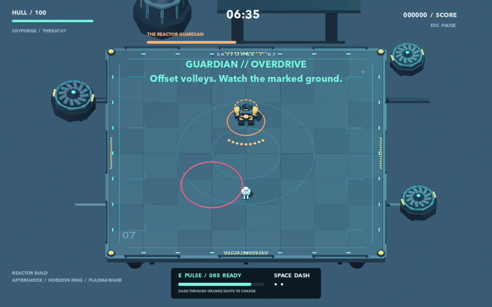
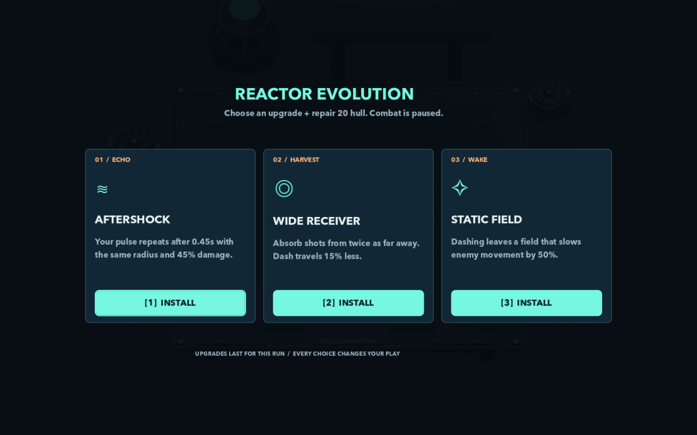
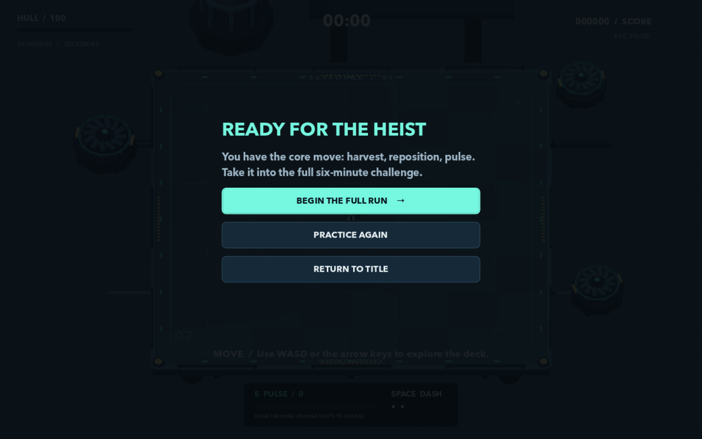

# Player guide

**Current release: [Pulsebreak 1.2.0](RELEASE_1_2.md).** **Begin Skybound** starts continuous generated sectors: clear enemies, reach airborne relays, cross moving gates, upgrade at checkpoints and fight recurring Guardians. At checkpoints you can continue or bank the score. See [Overdrive](OVERDRIVE.md) for the four weapons, five ranks and endless progression.

**F** jumps; hold through the apex to glide. **Q** cycles unlocked weapons. Flight is available in Classic too. [Skybound](SKYBOUND.md) records the earlier authored three-sector campaign and explains relays, moving shutters and wing fuel. The six-minute survival and timed-upgrade sections below describe **Classic**.

## Objective and controls

In Classic, survive six minutes of waves, then destroy the Reactor Guardian. In Skybound, complete sector objectives and keep progressing through checkpoints. Your automatic weapon handles nearby targets; the central skill is turning enemy projectiles into pulse energy.

| Input | Action |
|---|---|
| WASD or arrow keys | Move relative to the screen |
| Space | Dash in the currently held direction; use last facing when stationary |
| E | Spend stored energy on a pulse |
| F | Jump; hold to glide |
| Q | Switch unlocked weapons |
| 1 / 2 / 3 | Install the corresponding offered upgrade |
| Esc | Pause/resume, access Quit Game, leave settings, or cancel a rebind |
| Tab / Shift+Tab | Move menu focus |
| Enter | Activate the focused menu control |
| Left / right | Adjust a focused slider |
| F11 | Toggle fullscreen |

Menus also accept clicks. Gameplay keys can be remapped in Settings, and teaching prompts update to reflect the bindings. Arrow movement remains available. Menu keys are reserved.

## Dash, harvest, pulse

You have two dash charges (three with the HARVEST resonance, below). They recharge sequentially at one charge every 1.5 seconds, faster with Ion Servos from the Hangar. A dash lasts about 0.18 seconds; charges do not allow overlapping dashes. Dashing protects against ordinary contact and projectile damage, but **active ground hazards can still hurt you**.

Dash through orange shots to consume them and collect energy. Normally, each absorbed shot supplies up to 10 energy, capped at 40 gained in one dash. Total energy is capped at 100. Ordinary kills also give 5 energy, providing a small fallback when there are few projectiles nearby.

A pulse needs at least 30 energy (the tick on the energy bar; Hot Capacitor marks raise it by 3 each) and spends the full stored amount. Kills also build a **combo**: each kill within 3 seconds of the last raises your score multiplier by 4% (up to +120%); taking damage resets it. More energy increases its radius and damage. Spending now can clear an immediate threat; waiting can catch a larger group. The default pulse radius is `4 + 0.044 × energy`, and damage is `27 + 0.82 × energy` before upgrades.

Keep an escape route when harvesting. A dash that steals several shots can still leave you beside a charger or inside a future ground burst. After taking damage, a 0.75-second recovery period prevents many overlapping hits from consuming the whole hull at once.

## Enemy language

| Enemy | Behavior | Response to learn |
|---|---|---|
| Gunner | Maintains distance and fires orange fan volleys | Face the incoming shots and harvest through them |
| Charger | Locks a predicted direction during windup, then lunges along its marked lane | Leave the committed lane; the lunge stops at its first wall intersection |
| Bruiser | Uses frontal shielding, projectiles, and a marked ground attack | Pulse to break its shield; ordinary fire from behind avoids the front reduction |
| Splitter | Two fused cores in one shell; fires small volleys and splits into two fast mites when destroyed | Be ready for the pair it leaves behind; mites lunge like small chargers |
| Reactor Guardian | Larger volleys and ground attacks; adds pressure below half hull | Alternate harvesting opportunities with escape from marked ground |

From sector five of Skybound, some machines are **elites**, ringed in their affix color: gold **swift** (faster), white **armored** (more hull), red **volatile** (leaves a marked blast when destroyed). Elites pay double score.

New machines have a brief arrival period before becoming vulnerable. The warning strip shows a charger's committed path. Pink/red ground rings warn about an area attack and remain a different hazard from absorbable orange bullets.

*Staged source capture used to inspect the boss's visual language.*

## Upgrades

Combat pauses for a choice of three at minutes one through five in Classic, and at every Skybound checkpoint. Choose one, repair **20 hull**, and resume.

Each of the nine upgrades has **three marks**. Drafts mix new systems with mark raises (27 picks in total), so a long Skybound run keeps making build decisions. Marks scale both the effect and its tradeoff; Mk III adds a twist. Every card shows the exact effect of the mark you are about to install.

| Upgrade | Family | Mk I → II → III (summary) |
|---|---|---|
| Wide Receiver | Harvest | Absorb reach ×1.9 → ×2.4 and shots bend toward you → ×3.0 and harvesting refunds dash recharge. Dash travels 15/20/25% less |
| Hot Capacitor | Harvest | 15 energy/shot, 60/dash → 18, 75 → 22, 90 and dashing at a full battery vents 30 as a mini-pulse. Pulse threshold +3 per mark |
| Life Circuit | Harvest | Heal 2/shot → 3 and bank up to 10 spare hull → 4; at a full bank, healing becomes score and combo time |
| Aftershock | Echo | Echo at 45% → 60% with knockback → two echoes (60% + 35%) that follow you. Main blast −10% |
| Horizon Ring | Echo | Radius +35% → +55% and rim enemies are pulled in → +80% and a 1.2s burning rim. Damage −5% per mark |
| Chain Reaction | Echo | 4 arcs at 70% → 6 at 80%, preferring healthy targets → 8 at 90%, kills refund energy. Main blast −5% per mark |
| Plasma Wake | Wake | Burning dash trail 2s → hotter, 3s → 4s, and your pulse ignites live trails |
| Static Field | Wake | Slow 50% → 65% and slowed take +15% weapon damage → 75% and 1.5s slowed shatters |
| Flare Drive | Wake | Dash-through 24, pulses +20% → 36, +30% → 50, +40%, and a dash kill restores a dash charge |

Owning all three upgrades of a family grants its **resonance**: HARVEST +1 dash charge, ECHO pulse radius +8%, WAKE combo window +25%. Cards show family progress (n/3) and the resonance effect.

Aftershock uses the full original pulse power as its input and applies its damage multiplier afterward. This matters because the base damage formula is not proportional to energy alone.

## Salvage cores and the Hangar

Every run earns **salvage cores** from kills, score and Guardians (a lost run pays 60%; banking or winning pays in full). Cores are never lost. Spend them in the **Hangar** on the title screen: six permanent perks with three ranks each (hull, dash recharge, harvest yield, starting energy, weapon damage, combo window), plus repeatable **Overcharge cells** at rising cost for +1% score each. Perks apply to real runs, not Practice.

*Staged upgrade selection screen.*

## Repairs, boss transition, and scoring

An optional amber core first appears around 45 seconds, then roughly once per minute during waves. It remains for 12 seconds. Reaching it restores up to 22 hull, adds up to 20 energy, and awards 150 points. The route may cross enemy pressure; skipping it does not block progression.

At six minutes, normal enemies and old projectiles are cleared, the player is repositioned, up to 25 hull is restored, and energy is raised to at least the current pulse threshold. The Guardian then begins. Its second phase starts below half hull. A successful automated run lasted about 46 seconds beyond the wave phase; a human run can differ.

Score comes from kills (multiplied by your current combo), cores, elites at double value, and the boss reward. Harvesting itself is not a way to farm points indefinitely. Victory or death shows your score and installed build, with an immediate restart option.

## Practice and settings

Practice is outside the normal run timer. It teaches movement, one actual projectile absorption, one successful direct pulse hit, and a short charger encounter. A missed pulse leaves the lesson active with a retry hint. The completion screen offers a full run, another practice, or the title screen.

Assist slows enemy attack timing. Low Effects reduces visual-effect pressure and shadows. Volume and shake are adjustable. A win unlocks **Overdrive**, which increases enemy toughness and wave pressure; changing it applies to the next run. Progress and settings save locally. There is no mid-run save, multiplayer, or controller support in this experiment.

The alternate trail-focused driver did not win the recorded normal trial. Treat build advice here as a description of mechanics, not a promise that every combination has already been balanced through human play.
